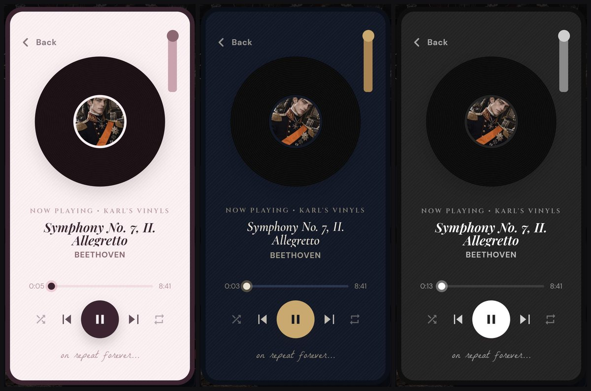
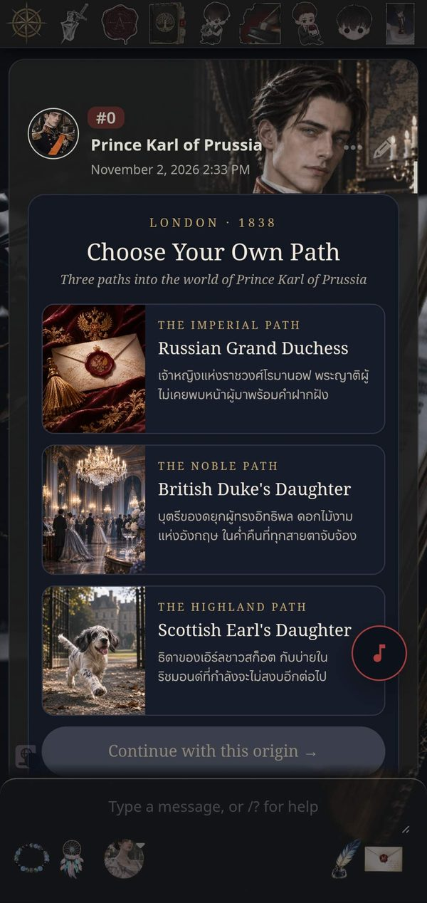
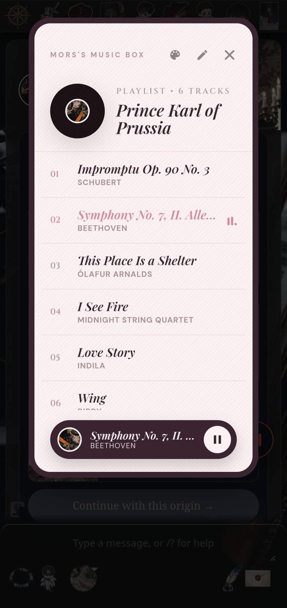
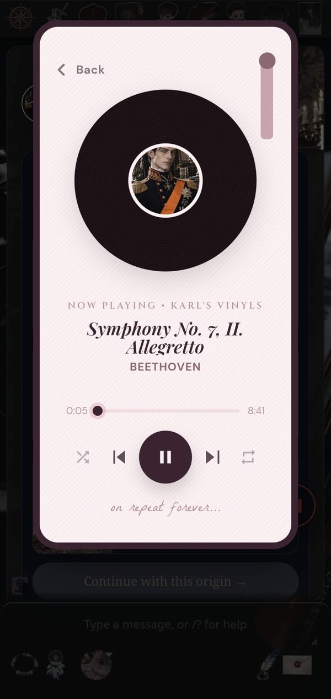
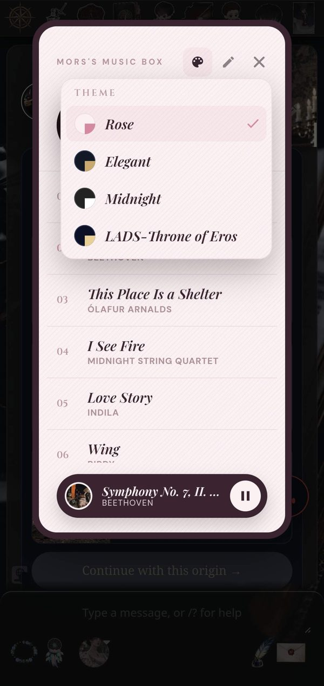
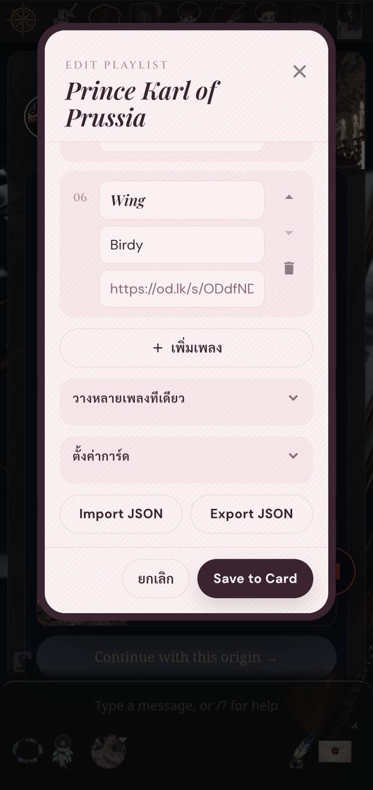
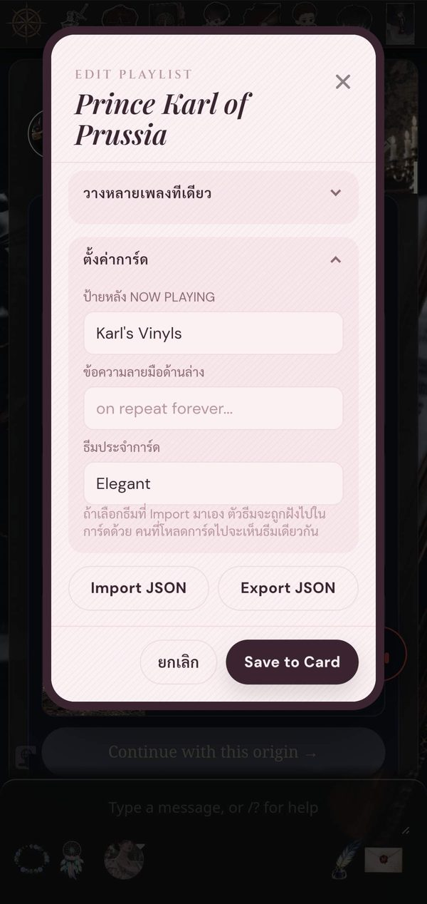
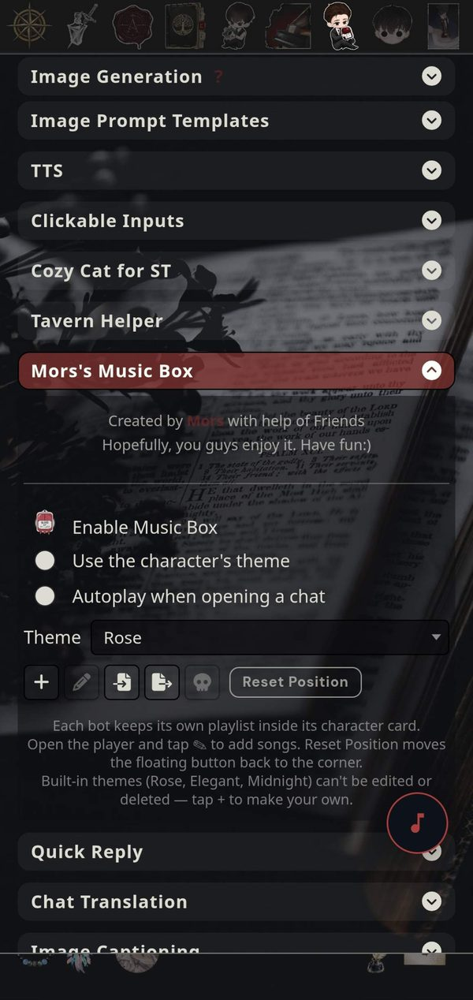
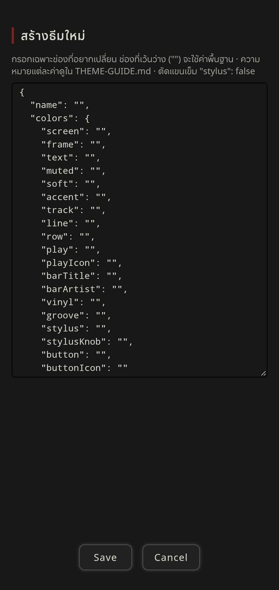

# Mors's Music Box

A floating music player for SillyTavern. Every bot carries its own playlist inside its character card, so the music travels with the bot.



> **Note:** Music Box plays audio files from links you provide. It does not stream from YouTube, Spotify or SoundCloud.

## ✨ Features

* **Floating Button:** A small ♪ button that sits over your chat. Drag it anywhere; it turns into a little equalizer while music is playing. Built for phones first, works on desktop too.



* **Playlist per Bot:** Songs are saved inside the character card itself. They come along when you export the card as a PNG, and they are never sent to the AI, so they don't cost any tokens.



* **Vinyl Player:** The bot's avatar becomes the record label. Shuffle, previous, play/pause, next and repeat (all / one / off) sit in one row. You can also control playback from your phone's lock screen.



* **Themes:** Three built-in themes (**Rose**, **Elegant**, **Midnight**). Tap the palette button to switch, or press and hold it to pick from the list. You can also make your own (see [Themes](#-themes)).



* **Playlist Editor:** Add songs one by one, paste many at once, reorder them, and import or export the list as JSON. Each card can also set its own label, handwritten line and theme.

 

* **Smooth Track Changes:** Once the current song has finished downloading, the next one loads in the background, so it starts right away. On slow connections or Data Saver, this is skipped so it never competes with the song you're listening to.

## 📦 Installation

1. Open SillyTavern.
2. Go to **Extensions → Install extension**.
3. Paste this link and click **Install**:
   ```
   https://github.com/Mors1212/mors-music-box
   ```
4. Reload the page. The ♪ button appears in the bottom-right corner.

To update later: **Extensions → Manage extensions → Update** next to Mors's Music Box.

## 🎵 Adding Songs

1. Open a chat with a bot (one-on-one chats only; group chats aren't supported).
2. Tap the ♪ button, then the ✎ pencil in the top-right corner.
3. Add songs:
   * **One at a time:** tap **+ เพิ่มเพลง** (Add song) and fill in the title, artist (optional) and link.
   * **Many at once:** open **วางหลายเพลงทีเดียว** (Paste many songs) and add one song per line:
     ```
     Waltz in A minor | https://files.catbox.moe/aaaa.mp3
     Richmond Nocturne | https://files.catbox.moe/bbbb.mp3
     ```
4. *(Optional)* Under **ตั้งค่าการ์ด** (Card settings), set the label shown after "NOW PLAYING", the handwritten line under the controls, and a theme for this card.
5. Tap **Save to Card**.


### Which links work?

The link must open the audio file directly (mp3, ogg, m4a or wav).

| Works | Converted for you | Doesn't work |
|---|---|---|
| Catbox (`files.catbox.moe/…`) · GitHub raw · jsDelivr · OpenDrive | Dropbox share links · GitHub `/blob/` links · Google Drive `/file/d/…` links | YouTube · Spotify · SoundCloud · any page that isn't the file itself |

Tip: smaller files (for example 128 kbps MP3) start faster on mobile data.

## 🎨 Themes

Pick a theme in the extension panel or with the palette button in the player.

You can create your own theme without leaving SillyTavern: tap **+** in the panel and fill in a JSON template. Every setting is listed with a blank value, so you only fill in what you want to change. Themes can change:

* every colour (screen, frame, text, buttons, divider lines, the "now playing" bar…)
* fonts (any Google Font)
* a background picture, with an option to dim it so text stays readable
* the record (use your own picture, hide the grooves or the avatar)
* the tone arm (remove it or replace it with your own picture)

Full reference with a labelled diagram: **[THEME-GUIDE.md](THEME-GUIDE.md)** or **[THEME-GUIDE-TH.md](THEME-GUIDE.th.md)**

Ready-made examples to import: **[theme-samples/](theme-samples)**


If you choose an imported theme as a card's theme, the theme is saved into the card too, so anyone who loads the card sees it.

## ⚙️ Settings

Find these under **Extensions → Mors's Music Box**.

 

| Setting | What it does |
|---|---|
| **Enable Music Box** | Shows or hides the floating button. |
| **Use the character's theme** | When a card has its own theme, use it. Turn off to always use your own pick. |
| **Autoplay when opening a chat** | Starts the bot's playlist when you open its chat. Browsers may block this until you tap the screen once. |
| **Theme** | Your default theme. |
| ➕ | Create a new theme. |
| ✏️ | Edit the selected theme. |
| 📥 / 📤 | Import a theme file / export the selected theme. |
| 💀 | Delete the selected theme. |
| **Reset Position** | Moves the floating button back to the corner. |

The built-in themes can't be edited or deleted. Tap ➕ to make your own version instead.

## ❓ Troubleshooting

* **A song won't play:** the link probably isn't a direct file link. Open it in your browser; it should start playing or downloading the audio, not show a web page.
* **Autoplay doesn't start:** browsers block sound until you interact with the page. Tap ▶ once.
* **The floating button is missing:** make sure **Enable Music Box** is on, then tap **Reset Position**.
* **The pencil button is hidden:** the playlist editor only works in a one-on-one chat with a bot.


