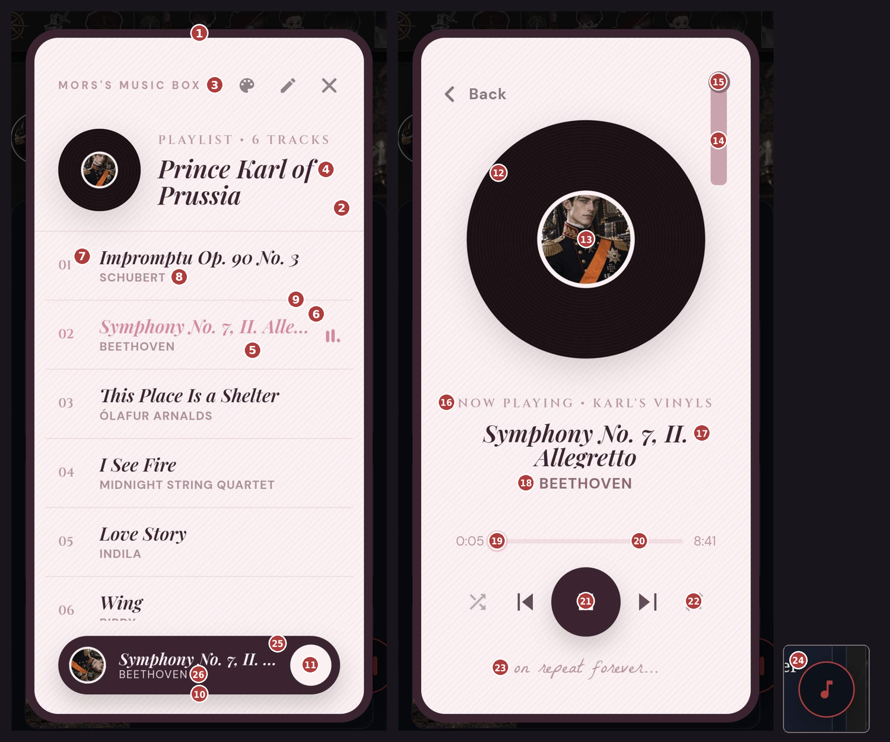

# Mors's Music Box — Theme Guide

**English** · [ภาษาไทย](THEME-GUIDE.th.md)

A theme is a single `.json` file. Add one under **Extensions → Mors's Music Box → Import theme**.
You only need to include the values you want to change. Anything left out, or left blank as `""`, uses the default.
You can also build a theme right inside SillyTavern: tap ➕ in the settings panel to get a template with every setting listed and nothing filled in.

The easiest way to start: open `theme-samples/my-theme-starter.mmb-theme.json` and change the colours one by one.
Or pick a theme you like and tap **Export theme** to get its file and edit from there.



---

## File structure

```json
{
  "name": "Theme name",
  "colors": { … },
  "fonts": { … },
  "texture": "paper",
  "background": "…",
  "disc": { … },
  "stylus": { … }
}
```

| Key | Required? | What it is |
|---|---|---|
| `name` | Recommended | The name shown in the theme list (up to 40 characters). |
| `id` | No | The theme's ID. If left out, it's made from `name`. Importing a file with the same `id` replaces the existing theme. |
| `colors` | No | Every colour. See the table below. |
| `fonts` | No | Fonts for 4 places. |
| `texture` | No | A pattern over the screen. |
| `background` | No | A full-screen background picture. |
| `disc` | No | How the record looks. |
| `stylus` | No | The tone arm. |
| `titleItalic` | No | Set to `false` for upright bot names and song titles (italic by default). |

---

## `colors`

Use `#ad3e3e`, `rgb(173,62,62)`, `rgba(173,62,62,0.1)` or a colour name like `white`.
Numbers in brackets match the pins in the picture above.

| Key | Controls |
|---|---|
| `screen` | The screen background (2) and the theme menu background. |
| `frame` | The thick border around the screen (1). |
| `text` | Main text: bot name (4), song titles in the list and player (17), the ⏮ ⏭ 🔀 🔁 buttons (22), the top-bar buttons and the dot on the progress bar. |
| `muted` | Faded text: MORS'S MUSIC BOX (3), PLAYLIST • … / NOW PLAYING • … (16), track numbers (7), times like 0:00, and the handwritten line (23). |
| `soft` | Artist names (8, 18) and secondary text in the playlist editor. |
| `accent` | Highlights: the selected song's title (6), the played part of the progress bar (19), the small dots under 🔀 🔁 when on, the equalizer next to the playing song, the tick in the theme menu, and input borders while typing. |
| `track` | The unplayed part of the progress bar (20), and the borders of pill buttons and inputs in the playlist editor. |
| `line` | Divider lines between songs (9) and in the playlist editor. If left out, uses `track`. |
| `row` | The selected song's row (5), rows when tapped, and boxes in the playlist editor. A faint `rgba` works best. |
| `play` | The big play button (21), the "now playing" bar at the bottom of the list (10), and the Save to Card button. |
| `playIcon` | The ▶ ⏸ icon in the play button, and the round button on the "now playing" bar (11). |
| `barTitle` | The song title on the "now playing" bar (25). If left out, uses `playIcon`. |
| `barArtist` | The artist on the "now playing" bar (26). If left out, uses a slightly faded `playIcon`. |
| `vinyl` | The record (12). |
| `groove` | The grooves on the record (12). |
| `stylus` | The tone arm (14). |
| `stylusKnob` | The round knob at the top of the tone arm (15). |
| `button` | The floating button's background (24). If left out, dark navy. |
| `buttonIcon` | The floating button's icon and border (24). If left out, `#ad3e3e`. |

> The ring around the avatar in the middle of the record (13) automatically uses the `screen` colour.

---

## `fonts`

Use any font name from [Google Fonts](https://fonts.google.com); it's loaded for you.
If a font has no Thai letters, Thai text falls back to Trirong / Sarabun / Mali automatically.

| Key | Used for | Default |
|---|---|---|
| `tag` | Small caps labels PLAYLIST / NOW PLAYING (16) and track numbers (7). | Cinzel |
| `title` | Bot name (4), song titles (6, 17) and names in the theme menu. | Playfair Display |
| `body` | General text, artist names, buttons and inputs. | DM Sans |
| `sign` | The handwritten line under the controls (23). | La Belle Aurore |

```json
"fonts": { "tag": "Cinzel", "title": "Cormorant Garamond", "body": "DM Sans", "sign": "Pinyon Script" }
```

---

## `texture`

A small pattern repeated over the screen (and over the `background` picture, if there is one).

| Value | Looks like |
|---|---|
| `"paper"` | Diagonal paper lines in greyish purple. Good for light screens. |
| `"paper-light"` | The same pattern, fainter. |
| `"paper-dark"` | The same pattern in faint white lines. Good for dark screens. |
| `"none"` | No pattern. |
| `"https://…"` | Your own picture, repeated as a pattern. |

---

## `background`

```json
"background": "https://files.catbox.moe/xxxx.jpg"
```
The picture is stretched to fill the player screen (a 1:2 ratio such as 640×1280 px fits best).
For a small pattern you'd like repeated instead:
```json
"background": { "image": "https://…", "fit": "tile" }
```
**Dim the picture** so it doesn't drown out the text: `dim` is a see-through colour laid over it.
```json
"background": { "image": "https://…", "dim": "rgba(9, 12, 32, 0.8)" }
```
The last number (0–1) is how strong the overlay is; higher means a fainter picture. Using the same colour as `screen` blends best. Around `0.6–0.85` works well.

---

## `disc`

```json
"disc": { "image": "https://…/disc.png", "grooves": false, "label": true }
```

| Key | What it is |
|---|---|
| `image` | A picture that replaces the black record, both in the player and the small record on the list. It spins while playing. A round, square, transparent PNG works best, e.g. 440×440 px. |
| `grooves` | The groove pattern, `true` / `false`. Turned off automatically when you use `image`; set `true` to keep the grooves over your picture. |
| `label` | The bot's avatar in the middle of the record (13). Set `false` to hide it. |
| `glow` | A soft glow around the record. Give it a colour, e.g. `"rgba(232,207,150,0.16)"`. |

Without an `image` you can still use `"label": false`, or change the colours with `colors.vinyl` / `colors.groove`.

---

## `stylus`

**Remove it**
```json
"stylus": false
```

**Use your own picture**
```json
"stylus": { "image": "https://…/arm.png", "width": 52, "height": 130, "top": -46, "right": -26 }
```

| Key | What it is | Default |
|---|---|---|
| `image` | The tone arm picture, drawn upright. It pivots from the **middle of its top edge**. | — |
| `width`, `height` | Picture size (px). | 70 × 140 |
| `top` | Distance from the top of the record. Negative = raised above the record. | -40 |
| `right` | Distance from the right edge of the record. Negative = moved further right. | -30 |

When paused, the arm swings out 30°; when playing, it swings back upright.
Without an `image`, the arm is a plain bar coloured by `colors.stylus` / `colors.stylusKnob`.

---

## Adding pictures

Two ways:
1. **A link** starting with `https://`, e.g. from Catbox, GitHub (raw) or jsDelivr.
2. **Packed into the file** as `data:image/png;base64,…` (or jpeg / webp / gif / svg+xml). The theme becomes one self-contained file you can share without hosting anything. The themes in `theme-samples` work this way (up to about 1.5 MB per picture).

Links that aren't `https`, or that aren't in the right format, are skipped quietly and the default is used instead.

---

## Themes and character cards

- In **Edit Playlist → Card settings** you can choose a **Card's theme**. If you choose a theme you imported, the whole theme is saved into the card, so anyone who loads the card sees the same theme even without the theme file.
- Players can turn this off with **Use the character's theme** if they always want their own theme.
- Themes with packed pictures make the card file larger by the size of those pictures.

---

## Full example

This is the whole `theme-samples/lavender-cd.mmb-theme.json` file. Paste it into ➕ New theme to try it.
The background and CD pictures are packed into the file as `data:image/svg+xml;base64,…`, which is why it's long. You can replace them with your own `https://…` links.

```json
{
  "name": "Lavender CD",
  "colors": {
    "screen": "#2a2140",
    "frame": "#17122a",
    "text": "#f2ecff",
    "muted": "#b7a9d6",
    "soft": "#cfc3ea",
    "accent": "#c9a7ff",
    "track": "#4a3d6b",
    "line": "#6c5a99",
    "play": "#c9a7ff",
    "playIcon": "#231b38",
    "row": "rgba(201,167,255,0.10)",
    "button": "#231b38",
    "buttonIcon": "#c9a7ff"
  },
  "fonts": {
    "tag": "Cinzel",
    "title": "Playfair Display",
    "body": "DM Sans",
    "sign": "La Belle Aurore"
  },
  "texture": "none",
  "background": "data:image/svg+xml;base64,PHN2ZyB4bWxucz0iaHR0cDovL3d3dy53My5vcmcvMjAwMC9zdmciIHdpZHRoPSIzMjAiIGhlaWdodD0iNjQwIiB2aWV3Qm94PSIwIDAgMzIwIDY0MCI+CjxkZWZzPjxsaW5lYXJHcmFkaWVudCBpZD0iZyIgeDE9IjAiIHkxPSIwIiB4Mj0iMCIgeTI9IjEiPjxzdG9wIG9mZnNldD0iMCIgc3RvcC1jb2xvcj0iIzNhMmQ1YyIvPjxzdG9wIG9mZnNldD0iMSIgc3RvcC1jb2xvcj0iIzFlMTczMyIvPjwvbGluZWFyR3JhZGllbnQ+CjxyYWRpYWxHcmFkaWVudCBpZD0iZ2xvdyIgY3g9IjAuNSIgY3k9IjAuMyIgcj0iMC42Ij48c3RvcCBvZmZzZXQ9IjAiIHN0b3AtY29sb3I9IiNiNDhjZmYiIHN0b3Atb3BhY2l0eT0iLjI4Ii8+PHN0b3Agb2Zmc2V0PSIxIiBzdG9wLWNvbG9yPSIjYjQ4Y2ZmIiBzdG9wLW9wYWNpdHk9IjAiLz48L3JhZGlhbEdyYWRpZW50PjwvZGVmcz4KPHJlY3Qgd2lkdGg9IjMyMCIgaGVpZ2h0PSI2NDAiIGZpbGw9InVybCgjZykiLz48cmVjdCB3aWR0aD0iMzIwIiBoZWlnaHQ9IjY0MCIgZmlsbD0idXJsKCNnbG93KSIvPgo8ZyBmaWxsPSIjZTlkY2ZmIj4KPGNpcmNsZSBjeD0iNDAiIGN5PSI2MCIgcj0iMS40IiBvcGFjaXR5PSIuNyIvPjxjaXJjbGUgY3g9IjI3MCIgY3k9IjQwIiByPSIxIiBvcGFjaXR5PSIuNiIvPjxjaXJjbGUgY3g9IjIxMCIgY3k9IjEyMCIgcj0iMS42IiBvcGFjaXR5PSIuNSIvPgo8Y2lyY2xlIGN4PSI3MCIgY3k9IjMwMCIgcj0iMS4xIiBvcGFjaXR5PSIuNSIvPjxjaXJjbGUgY3g9IjI5MCIgY3k9IjI2MCIgcj0iMS40IiBvcGFjaXR5PSIuNiIvPjxjaXJjbGUgY3g9IjE2MCIgY3k9IjQyMCIgcj0iMSIgb3BhY2l0eT0iLjUiLz4KPGNpcmNsZSBjeD0iMzAiIGN5PSI1MjAiIHI9IjEuNSIgb3BhY2l0eT0iLjYiLz48Y2lyY2xlIGN4PSIyNTAiIGN5PSI1NjAiIHI9IjEuMiIgb3BhY2l0eT0iLjUiLz48Y2lyY2xlIGN4PSIxMjAiIGN5PSI2MDAiIHI9IjEiIG9wYWNpdHk9Ii40Ii8+CjxwYXRoIGQ9Ik0yNTUgMTgwIGwyIDYgNiAyIC02IDIgLTIgNiAtMiAtNiAtNiAtMiA2IC0yeiIgb3BhY2l0eT0iLjU1Ii8+PHBhdGggZD0iTTUwIDQzMCBsMS41IDQuNSA0LjUgMS41IC00LjUgMS41IC0xLjUgNC41IC0xLjUgLTQuNSAtNC41IC0xLjUgNC41IC0xLjV6IiBvcGFjaXR5PSIuNSIvPgo8L2c+PC9zdmc+",
  "disc": {
    "image": "data:image/svg+xml;base64,PHN2ZyB4bWxucz0iaHR0cDovL3d3dy53My5vcmcvMjAwMC9zdmciIHdpZHRoPSI0MDAiIGhlaWdodD0iNDAwIiB2aWV3Qm94PSIwIDAgNDAwIDQwMCI+CjxkZWZzPgo8bGluZWFyR3JhZGllbnQgaWQ9ImEiIHgxPSIwIiB5MT0iMCIgeDI9IjEiIHkyPSIxIj48c3RvcCBvZmZzZXQ9IjAiIHN0b3AtY29sb3I9IiNmNGYxZmYiLz48c3RvcCBvZmZzZXQ9Ii4yNSIgc3RvcC1jb2xvcj0iI2NmYzZmZiIvPjxzdG9wIG9mZnNldD0iLjQ1IiBzdG9wLWNvbG9yPSIjZmZlMGYzIi8+PHN0b3Agb2Zmc2V0PSIuNiIgc3RvcC1jb2xvcj0iI2Q0ZjVmZiIvPjxzdG9wIG9mZnNldD0iLjgiIHN0b3AtY29sb3I9IiNlMmQ2ZmYiLz48c3RvcCBvZmZzZXQ9IjEiIHN0b3AtY29sb3I9IiNiZmIzZTYiLz48L2xpbmVhckdyYWRpZW50Pgo8bGluZWFyR3JhZGllbnQgaWQ9ImIiIHgxPSIxIiB5MT0iMCIgeDI9IjAiIHkyPSIxIj48c3RvcCBvZmZzZXQ9IjAiIHN0b3AtY29sb3I9IiNmZmYiIHN0b3Atb3BhY2l0eT0iLjU1Ii8+PHN0b3Agb2Zmc2V0PSIuNSIgc3RvcC1jb2xvcj0iI2ZmZiIgc3RvcC1vcGFjaXR5PSIwIi8+PHN0b3Agb2Zmc2V0PSIxIiBzdG9wLWNvbG9yPSIjZmZmIiBzdG9wLW9wYWNpdHk9Ii40Ii8+PC9saW5lYXJHcmFkaWVudD4KPG1hc2sgaWQ9Im0iPjxyZWN0IHdpZHRoPSI0MDAiIGhlaWdodD0iNDAwIiBmaWxsPSIjZmZmIi8+PGNpcmNsZSBjeD0iMjAwIiBjeT0iMjAwIiByPSIyMiIgZmlsbD0iIzAwMCIvPjwvbWFzaz48L2RlZnM+CjxnIG1hc2s9InVybCgjbSkiPgo8Y2lyY2xlIGN4PSIyMDAiIGN5PSIyMDAiIHI9IjE5OCIgZmlsbD0idXJsKCNhKSIvPjxjaXJjbGUgY3g9IjIwMCIgY3k9IjIwMCIgcj0iMTk4IiBmaWxsPSJ1cmwoI2IpIi8+CjxnIGZpbGw9Im5vbmUiIHN0cm9rZT0iI2ZmZmZmZiIgc3Ryb2tlLW9wYWNpdHk9Ii4yNSI+CjxjaXJjbGUgY3g9IjIwMCIgY3k9IjIwMCIgcj0iMTgwIi8+PGNpcmNsZSBjeD0iMjAwIiBjeT0iMjAwIiByPSIxNjAiLz48Y2lyY2xlIGN4PSIyMDAiIGN5PSIyMDAiIHI9IjE0MCIvPjxjaXJjbGUgY3g9IjIwMCIgY3k9IjIwMCIgcj0iMTIwIi8+PGNpcmNsZSBjeD0iMjAwIiBjeT0iMjAwIiByPSIxMDAiLz48Y2lyY2xlIGN4PSIyMDAiIGN5PSIyMDAiIHI9IjgwIi8+PC9nPgo8Y2lyY2xlIGN4PSIyMDAiIGN5PSIyMDAiIHI9IjYyIiBmaWxsPSIjZWZlYWZmIiBzdHJva2U9IiNiZGIyZTgiIHN0cm9rZS13aWR0aD0iMiIvPgo8Y2lyY2xlIGN4PSIyMDAiIGN5PSIyMDAiIHI9IjE5OCIgZmlsbD0ibm9uZSIgc3Ryb2tlPSIjYTk5YmQ2IiBzdHJva2Utd2lkdGg9IjMiLz48L2c+PC9zdmc+",
    "label": true
  },
  "stylus": false
}
```
