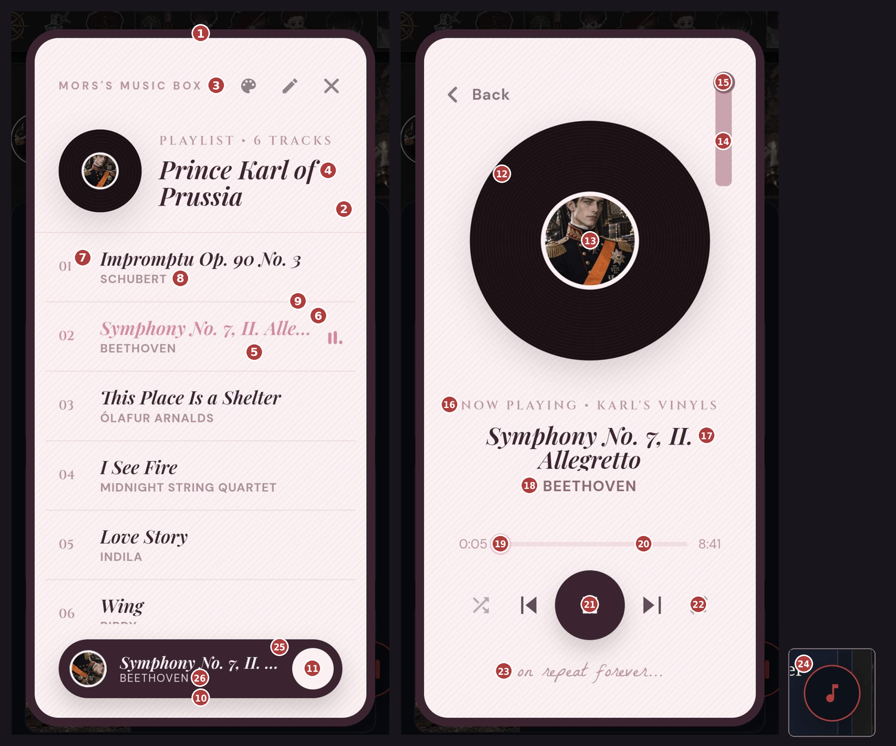

# Mors's Music Box — Theme Guide

[English](THEME-GUIDE.md) · **ภาษาไทย**

ธีมคือไฟล์ `.json` ไฟล์เดียว เอาเข้าได้ที่ **Extensions → Mors's Music Box → Import theme**
ใส่เฉพาะค่าที่อยากเปลี่ยนก็ได้ ค่าไหนไม่ใส่ หรือเว้นว่างเป็น `""` จะใช้ค่าพื้นฐานแทน
สร้างธีมในตัวได้เลยที่ปุ่ม ➕ ในหน้าตั้งค่า จะได้แม่แบบที่มีทุกหัวข้อแต่ยังไม่กรอกค่า

วิธีที่ง่ายที่สุด: เปิด `theme-samples/my-theme-starter.mmb-theme.json` แล้วแก้สีทีละช่อง
หรือเลือกธีมที่ชอบแล้วกด **Export theme** เพื่อได้ไฟล์ของธีมนั้นมาแก้ต่อ



---

## โครงไฟล์

```json
{
  "name": "ชื่อธีม",
  "colors": { … },
  "fonts": { … },
  "texture": "paper",
  "background": "…",
  "disc": { … },
  "stylus": { … }
}
```

| ค่า | ต้องใส่ไหม | คืออะไร |
|---|---|---|
| `name` | ควรใส่ | ชื่อที่โชว์ในลิสต์ธีม (ไม่เกิน 40 ตัวอักษร) |
| `id` | ไม่ต้อง | รหัสธีม ถ้าไม่ใส่จะสร้างจาก `name` ให้ Import ไฟล์ที่ `id` ซ้ำจะทับธีมเดิม |
| `colors` | ไม่ต้อง | สีทุกส่วน ดูตารางด้านล่าง |
| `fonts` | ไม่ต้อง | ฟอนต์ 4 ตำแหน่ง |
| `texture` | ไม่ต้อง | ลายบนพื้นจอ |
| `background` | ไม่ต้อง | รูปพื้นหลังเต็มจอ |
| `disc` | ไม่ต้อง | หน้าตาแผ่นเสียง |
| `stylus` | ไม่ต้อง | แขนเข็ม |
| `titleItalic` | ไม่ต้อง | ใส่ `false` ให้ชื่อบอท/ชื่อเพลงเป็นตัวตรง (ค่าเริ่มต้นเป็นตัวเอียง) |

---

## `colors` — สี

ใส่ได้ทั้ง `#ad3e3e`, `rgb(173,62,62)`, `rgba(173,62,62,0.1)` หรือชื่อสีอย่าง `white`
เลขในวงเล็บตรงกับหมุดในภาพด้านบน

| ค่า | คุมส่วนไหน |
|---|---|
| `screen` | พื้นจอ (2) และพื้นของเมนูธีม |
| `frame` | กรอบหนารอบจอ (1) |
| `text` | ตัวหนังสือหลัก: ชื่อบอท (4), ชื่อเพลงในลิสต์และหน้าเครื่องเล่น (17), ปุ่ม ⏮ ⏭ 🔀 🔁 (22), ปุ่มบนแถบด้านบน และจุดกลมบนแถบเวลา |
| `muted` | ตัวหนังสือจาง: MORS'S MUSIC BOX (3), PLAYLIST • … / NOW PLAYING • … (16), เลขลำดับเพลง (7), เวลา 0:00, ข้อความลายมือ (23) |
| `soft` | ชื่อศิลปิน (8, 18) และข้อความรองในหน้าแก้เพลย์ลิสต์ |
| `accent` | สีเน้น: ชื่อเพลงที่เลือกอยู่ (6), แถบเวลาส่วนที่เล่นไปแล้ว (19), จุดเล็กใต้ 🔀 🔁 ตอนเปิด, แท่งอีควอไลเซอร์ข้างเพลงที่กำลังเล่น, ติ๊กในเมนูธีม, กรอบช่องพิมพ์ตอนแตะ |
| `track` | แถบเวลาส่วนที่ยังไม่เล่น (20), ขอบปุ่มทรงแคปซูลและช่องพิมพ์ในหน้าแก้เพลย์ลิสต์ |
| `line` | เส้นคั่นระหว่างเพลง (9) และเส้นคั่นในหน้าแก้เพลย์ลิสต์ ไม่ใส่ = ใช้สีเดียวกับ `track` |
| `row` | พื้นแถวเพลงที่เลือกอยู่ (5), พื้นตอนแตะแถว, พื้นกล่องในหน้าแก้เพลย์ลิสต์ แนะนำใช้ `rgba` จาง ๆ |
| `play` | ปุ่มเล่นใหญ่ (21), แถบ "กำลังเล่น" ด้านล่างหน้าลิสต์ (10), ปุ่ม Save to Card |
| `playIcon` | ไอคอน ▶ ⏸ ในปุ่มเล่น และปุ่มกลมบนแถบ "กำลังเล่น" (11) |
| `barTitle` | ชื่อเพลงบนแถบ "กำลังเล่น" ด้านล่างหน้าลิสต์ (25) ไม่ใส่ = ใช้สี `playIcon` |
| `barArtist` | ชื่อศิลปินบนแถบ "กำลังเล่น" (26) ไม่ใส่ = สี `playIcon` แบบจางลงเล็กน้อย |
| `vinyl` | สีแผ่นเสียง (12) |
| `groove` | สีลายร่องบนแผ่นเสียง (12) |
| `stylus` | สีแขนเข็ม (14) |
| `stylusKnob` | สีปุ่มกลมบนหัวแขนเข็ม (15) |
| `button` | พื้นปุ่มลอยเปิดเครื่องเล่น (24) ไม่ใส่ = กรมท่าเข้ม |
| `buttonIcon` | ไอคอนกับขอบของปุ่มลอย (24) ไม่ใส่ = `#ad3e3e` |

> ขอบกลมรอบรูป avatar กลางแผ่น (13) ใช้สีเดียวกับ `screen` อัตโนมัติ

---

## `fonts` — ฟอนต์

ใส่ชื่อฟอนต์จาก [Google Fonts](https://fonts.google.com) ได้เลย ระบบโหลดให้เอง
ฟอนต์ที่ไม่มีภาษาไทย ตัวไทยจะใช้ฟอนต์สำรองแทนอัตโนมัติ (Trirong / Sarabun / Mali)

| ค่า | ใช้กับ | ค่าเริ่มต้น |
|---|---|---|
| `tag` | ป้ายเล็กตัวพิมพ์ใหญ่ PLAYLIST / NOW PLAYING (16) และเลขลำดับเพลง (7) | Cinzel |
| `title` | ชื่อบอท (4), ชื่อเพลง (6, 17), ชื่อในเมนูธีม | Playfair Display |
| `body` | ตัวหนังสือทั่วไป ชื่อศิลปิน ปุ่ม และช่องพิมพ์ | DM Sans |
| `sign` | ข้อความลายมือใต้ปุ่ม (23) | La Belle Aurore |

```json
"fonts": { "tag": "Cinzel", "title": "Cormorant Garamond", "body": "DM Sans", "sign": "Pinyon Script" }
```

---

## `texture` — ลายบนพื้นจอ

ลายเล็ก ๆ ที่ปูซ้ำทับพื้นจอ (และทับรูป `background` ถ้ามี)

| ค่า | หน้าตา |
|---|---|
| `"paper"` | ลายกระดาษทแยงสีเทาอมม่วง เหมาะกับพื้นสว่าง |
| `"paper-light"` | ลายเดียวกันแต่จางกว่า |
| `"paper-dark"` | ลายเดียวกันเป็นเส้นสีขาวจาง ๆ เหมาะกับพื้นมืด |
| `"none"` | ไม่มีลาย |
| `"https://…"` | รูปของเราเอง ปูซ้ำเป็นลาย |

---

## `background` — รูปพื้นหลัง

```json
"background": "https://files.catbox.moe/xxxx.jpg"
```
ยืดให้เต็มจอเครื่องเล่น (สัดส่วนจอ 1:2 เช่น 640×1280 px จะพอดีที่สุด)
ถ้าเป็นลายเล็กที่อยากให้ปูซ้ำ:
```json
"background": { "image": "https://…", "fit": "tile" }
```
**ทำให้รูปหม่นลง** ไม่ให้กลบเนื้อหา ใส่ `dim` เป็นสีโปร่งแสงที่จะเคลือบทับรูป
```json
"background": { "image": "https://…", "dim": "rgba(9, 12, 32, 0.8)" }
```
ตัวเลขท้าย (0–1) คือความเข้มของสีที่เคลือบ ยิ่งมากรูปยิ่งจาง ใช้สีเดียวกับ `screen` จะกลืนที่สุด ประมาณ `0.6–0.85` กำลังดี

---

## `disc` — แผ่นเสียง

```json
"disc": { "image": "https://…/disc.png", "grooves": false, "label": true }
```

| ค่า | คืออะไร |
|---|---|
| `image` | รูปแทนแผ่นเสียงสีดำ ทั้งในหน้าเครื่องเล่นและแผ่นเล็กหน้าลิสต์ รูปจะหมุนตอนเล่น แนะนำ PNG พื้นใส ทรงกลม จัตุรัส เช่น 440×440 px |
| `grooves` | ลายร่องแผ่น `true` / `false` ถ้าใส่ `image` จะปิดให้เอง อยากได้ลายทับรูปด้วยใส่ `true` |
| `label` | รูป avatar ของบอทตรงกลางแผ่น (13) ใส่ `false` เพื่อซ่อน |
| `glow` | แสงเรืองรอบแผ่น ใส่เป็นสี เช่น `"rgba(232,207,150,0.16)"` |

ไม่ใส่ `image` ก็ปรับแค่ `"label": false` หรือเปลี่ยนสีผ่าน `colors.vinyl` / `colors.groove` ได้

---

## `stylus` — แขนเข็ม

**เอาออก**
```json
"stylus": false
```

**ใช้รูปของเราเอง**
```json
"stylus": { "image": "https://…/arm.png", "width": 52, "height": 130, "top": -46, "right": -26 }
```

| ค่า | คืออะไร | ค่าเริ่มต้น |
|---|---|---|
| `image` | รูปแขนเข็ม วาดแนวตั้ง จุดหมุนอยู่**กึ่งกลางขอบบน**ของรูป | — |
| `width`, `height` | ขนาดรูป (px) | 70 × 140 |
| `top` | ระยะจากขอบบนของแผ่นเสียง ติดลบ = ยกขึ้นเหนือแผ่น | -40 |
| `right` | ระยะจากขอบขวาของแผ่นเสียง ติดลบ = เลื่อนออกไปทางขวา | -30 |

ตอนหยุด แขนจะเอียงออก 30° ตอนเล่นจะหมุนกลับมาตั้งตรง
ถ้าไม่ใส่ `image` แขนเข็มจะเป็นแท่งสีเรียบตาม `colors.stylus` / `colors.stylusKnob`

---

## ใส่รูปยังไง

ใช้ได้สองแบบ:
1. **ลิงก์** ขึ้นต้นด้วย `https://` เช่นจาก Catbox, GitHub (raw) หรือ jsDelivr
2. **ฝังรูปไว้ในไฟล์** เป็น `data:image/png;base64,…` (หรือ jpeg / webp / gif / svg+xml) ไฟล์ธีมจะเป็นไฟล์เดียวจบ ส่งต่อคนอื่นได้เลยไม่ต้องฝากรูป ธีมตัวอย่างใน `theme-samples` ใช้วิธีนี้ (รูปละไม่เกินประมาณ 1.5 MB)

ลิงก์ที่ไม่ใช่ `https` หรือรูปแบบผิด จะถูกข้ามไปเงียบ ๆ แล้วใช้ค่าพื้นฐานแทน

---

## ธีมกับการ์ดบอท

- ในหน้า **Edit Playlist → ตั้งค่าการ์ด** เลือก **ธีมประจำการ์ด** ได้ ถ้าเลือกธีมที่ Import มาเอง ตัวธีมทั้งไฟล์จะถูกฝังไปในการ์ด คนที่โหลดการ์ดไปจะเห็นธีมเดียวกันแม้ไม่มีไฟล์ธีม
- ผู้เล่นปิดได้ที่ **Use the character's theme** ถ้าอยากใช้ธีมของตัวเองเสมอ
- ธีมที่ฝังรูปไว้จะทำให้ไฟล์การ์ดใหญ่ขึ้นตามขนาดรูป

---

## ตัวอย่างเต็ม

นี่คือไฟล์ `theme-samples/lavender-cd.mmb-theme.json` ทั้งไฟล์ ก๊อปไปวางในหน้า ➕ สร้างธีมใหม่ได้เลย
รูปพื้นหลังกับรูปแผ่น CD ฝังไว้ในไฟล์เป็น `data:image/svg+xml;base64,…` จึงยาวหน่อย ถ้าใช้รูปของตัวเองแทนเป็นลิงก์ `https://…` ได้

```json
{
  "name": "Lavender CD",
  "colors": {
    "screen": "#2a2140",
    "frame": "#17122a",
    "text": "#f2ecff",
    "muted": "#b7a9d6",
    "soft": "#cfc3ea",
    "accent": "#c9a7ff",
    "track": "#4a3d6b",
    "line": "#6c5a99",
    "play": "#c9a7ff",
    "playIcon": "#231b38",
    "row": "rgba(201,167,255,0.10)",
    "button": "#231b38",
    "buttonIcon": "#c9a7ff"
  },
  "fonts": {
    "tag": "Cinzel",
    "title": "Playfair Display",
    "body": "DM Sans",
    "sign": "La Belle Aurore"
  },
  "texture": "none",
  "background": "data:image/svg+xml;base64,PHN2ZyB4bWxucz0iaHR0cDovL3d3dy53My5vcmcvMjAwMC9zdmciIHdpZHRoPSIzMjAiIGhlaWdodD0iNjQwIiB2aWV3Qm94PSIwIDAgMzIwIDY0MCI+CjxkZWZzPjxsaW5lYXJHcmFkaWVudCBpZD0iZyIgeDE9IjAiIHkxPSIwIiB4Mj0iMCIgeTI9IjEiPjxzdG9wIG9mZnNldD0iMCIgc3RvcC1jb2xvcj0iIzNhMmQ1YyIvPjxzdG9wIG9mZnNldD0iMSIgc3RvcC1jb2xvcj0iIzFlMTczMyIvPjwvbGluZWFyR3JhZGllbnQ+CjxyYWRpYWxHcmFkaWVudCBpZD0iZ2xvdyIgY3g9IjAuNSIgY3k9IjAuMyIgcj0iMC42Ij48c3RvcCBvZmZzZXQ9IjAiIHN0b3AtY29sb3I9IiNiNDhjZmYiIHN0b3Atb3BhY2l0eT0iLjI4Ii8+PHN0b3Agb2Zmc2V0PSIxIiBzdG9wLWNvbG9yPSIjYjQ4Y2ZmIiBzdG9wLW9wYWNpdHk9IjAiLz48L3JhZGlhbEdyYWRpZW50PjwvZGVmcz4KPHJlY3Qgd2lkdGg9IjMyMCIgaGVpZ2h0PSI2NDAiIGZpbGw9InVybCgjZykiLz48cmVjdCB3aWR0aD0iMzIwIiBoZWlnaHQ9IjY0MCIgZmlsbD0idXJsKCNnbG93KSIvPgo8ZyBmaWxsPSIjZTlkY2ZmIj4KPGNpcmNsZSBjeD0iNDAiIGN5PSI2MCIgcj0iMS40IiBvcGFjaXR5PSIuNyIvPjxjaXJjbGUgY3g9IjI3MCIgY3k9IjQwIiByPSIxIiBvcGFjaXR5PSIuNiIvPjxjaXJjbGUgY3g9IjIxMCIgY3k9IjEyMCIgcj0iMS42IiBvcGFjaXR5PSIuNSIvPgo8Y2lyY2xlIGN4PSI3MCIgY3k9IjMwMCIgcj0iMS4xIiBvcGFjaXR5PSIuNSIvPjxjaXJjbGUgY3g9IjI5MCIgY3k9IjI2MCIgcj0iMS40IiBvcGFjaXR5PSIuNiIvPjxjaXJjbGUgY3g9IjE2MCIgY3k9IjQyMCIgcj0iMSIgb3BhY2l0eT0iLjUiLz4KPGNpcmNsZSBjeD0iMzAiIGN5PSI1MjAiIHI9IjEuNSIgb3BhY2l0eT0iLjYiLz48Y2lyY2xlIGN4PSIyNTAiIGN5PSI1NjAiIHI9IjEuMiIgb3BhY2l0eT0iLjUiLz48Y2lyY2xlIGN4PSIxMjAiIGN5PSI2MDAiIHI9IjEiIG9wYWNpdHk9Ii40Ii8+CjxwYXRoIGQ9Ik0yNTUgMTgwIGwyIDYgNiAyIC02IDIgLTIgNiAtMiAtNiAtNiAtMiA2IC0yeiIgb3BhY2l0eT0iLjU1Ii8+PHBhdGggZD0iTTUwIDQzMCBsMS41IDQuNSA0LjUgMS41IC00LjUgMS41IC0xLjUgNC41IC0xLjUgLTQuNSAtNC41IC0xLjUgNC41IC0xLjV6IiBvcGFjaXR5PSIuNSIvPgo8L2c+PC9zdmc+",
  "disc": {
    "image": "data:image/svg+xml;base64,PHN2ZyB4bWxucz0iaHR0cDovL3d3dy53My5vcmcvMjAwMC9zdmciIHdpZHRoPSI0MDAiIGhlaWdodD0iNDAwIiB2aWV3Qm94PSIwIDAgNDAwIDQwMCI+CjxkZWZzPgo8bGluZWFyR3JhZGllbnQgaWQ9ImEiIHgxPSIwIiB5MT0iMCIgeDI9IjEiIHkyPSIxIj48c3RvcCBvZmZzZXQ9IjAiIHN0b3AtY29sb3I9IiNmNGYxZmYiLz48c3RvcCBvZmZzZXQ9Ii4yNSIgc3RvcC1jb2xvcj0iI2NmYzZmZiIvPjxzdG9wIG9mZnNldD0iLjQ1IiBzdG9wLWNvbG9yPSIjZmZlMGYzIi8+PHN0b3Agb2Zmc2V0PSIuNiIgc3RvcC1jb2xvcj0iI2Q0ZjVmZiIvPjxzdG9wIG9mZnNldD0iLjgiIHN0b3AtY29sb3I9IiNlMmQ2ZmYiLz48c3RvcCBvZmZzZXQ9IjEiIHN0b3AtY29sb3I9IiNiZmIzZTYiLz48L2xpbmVhckdyYWRpZW50Pgo8bGluZWFyR3JhZGllbnQgaWQ9ImIiIHgxPSIxIiB5MT0iMCIgeDI9IjAiIHkyPSIxIj48c3RvcCBvZmZzZXQ9IjAiIHN0b3AtY29sb3I9IiNmZmYiIHN0b3Atb3BhY2l0eT0iLjU1Ii8+PHN0b3Agb2Zmc2V0PSIuNSIgc3RvcC1jb2xvcj0iI2ZmZiIgc3RvcC1vcGFjaXR5PSIwIi8+PHN0b3Agb2Zmc2V0PSIxIiBzdG9wLWNvbG9yPSIjZmZmIiBzdG9wLW9wYWNpdHk9Ii40Ii8+PC9saW5lYXJHcmFkaWVudD4KPG1hc2sgaWQ9Im0iPjxyZWN0IHdpZHRoPSI0MDAiIGhlaWdodD0iNDAwIiBmaWxsPSIjZmZmIi8+PGNpcmNsZSBjeD0iMjAwIiBjeT0iMjAwIiByPSIyMiIgZmlsbD0iIzAwMCIvPjwvbWFzaz48L2RlZnM+CjxnIG1hc2s9InVybCgjbSkiPgo8Y2lyY2xlIGN4PSIyMDAiIGN5PSIyMDAiIHI9IjE5OCIgZmlsbD0idXJsKCNhKSIvPjxjaXJjbGUgY3g9IjIwMCIgY3k9IjIwMCIgcj0iMTk4IiBmaWxsPSJ1cmwoI2IpIi8+CjxnIGZpbGw9Im5vbmUiIHN0cm9rZT0iI2ZmZmZmZiIgc3Ryb2tlLW9wYWNpdHk9Ii4yNSI+CjxjaXJjbGUgY3g9IjIwMCIgY3k9IjIwMCIgcj0iMTgwIi8+PGNpcmNsZSBjeD0iMjAwIiBjeT0iMjAwIiByPSIxNjAiLz48Y2lyY2xlIGN4PSIyMDAiIGN5PSIyMDAiIHI9IjE0MCIvPjxjaXJjbGUgY3g9IjIwMCIgY3k9IjIwMCIgcj0iMTIwIi8+PGNpcmNsZSBjeD0iMjAwIiBjeT0iMjAwIiByPSIxMDAiLz48Y2lyY2xlIGN4PSIyMDAiIGN5PSIyMDAiIHI9IjgwIi8+PC9nPgo8Y2lyY2xlIGN4PSIyMDAiIGN5PSIyMDAiIHI9IjYyIiBmaWxsPSIjZWZlYWZmIiBzdHJva2U9IiNiZGIyZTgiIHN0cm9rZS13aWR0aD0iMiIvPgo8Y2lyY2xlIGN4PSIyMDAiIGN5PSIyMDAiIHI9IjE5OCIgZmlsbD0ibm9uZSIgc3Ryb2tlPSIjYTk5YmQ2IiBzdHJva2Utd2lkdGg9IjMiLz48L2c+PC9zdmc+",
    "label": true
  },
  "stylus": false
}
```
